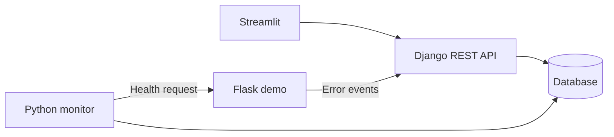

# IncidentLens

[](https://github.com/sevenhiremath/incidentlens/actions/workflows/checks.yml)

A Python web app for tracking service outages and writing down what happened.

I wanted to connect the monitoring side of my earlier infrastructure work with a proper backend application. IncidentLens checks a service, keeps the related events in a timeline, and helps a developer save an incident report. I use Streamlit for the interface so I can focus on Python and backend development.

**Status: first working milestone, v0.1.** Reports currently use a template filled with recorded evidence. AI generation and Celery are next steps, not features in this version.


This screenshot is from the local walkthrough. The service shows stale because the one-shot monitor has stopped; the recovered incident stays in history.

## What works

- Log in, register services, and pause or resume monitoring.
- Check health endpoints from a separate Python process.
- View success rate, failed checks, and average response time for up to 100 recent health checks.
- Open an incident after three failed checks and confirm recovery after two successful checks.
- Receive application errors through a service-key protected API.
- Ignore duplicate event IDs and attach relevant errors to an incident timeline.
- Filter incidents by service or status and search by service name or confirmed cause.
- Add the confirmed cause and fix, build a report, keep earlier revisions, and download Markdown.
- Restrict API access to each user's own services and incidents.

The dashboard shows **stale** when checks stop arriving. It does not keep showing an old successful check as current health.

## Measured backend performance

With 100 services and 10,000 seeded events, the service-list optimization reduced queries from **29 to 3** and p95 HTTP response time from **144.845 ms to 73.165 ms**. These are medians from three runs with eight clients on one PostgreSQL CI setup. The updated version also passed 6,000 error submissions, including 3,000 duplicate retries across three runs, without storing duplicate rows.

[Results, raw timings, and test conditions](docs/performance.md). This is a synthetic backend benchmark, not production capacity or browser performance.

## Stack

| Part | Choice |
| --- | --- |
| Interface | Streamlit |
| API | Django + Django REST Framework |
| Database | SQLite for a quick local run; PostgreSQL for row-locking tests and the Compose setup |
| Monitor | Django management command, run separately |
| Tests and checks | pytest, pytest-django, Streamlit AppTest, Ruff, GitHub Actions |
| Demo service | Flask |



The dashboard uses the API. The monitor uses the same Django models and incident logic, but it runs independently of the browser.

## Run locally

Requirements: Python 3.12 and [uv](https://docs.astral.sh/uv/getting-started/installation/). Run commands from the repository root.

```text
git clone https://github.com/sevenhiremath/incidentlens.git
cd incidentlens
uv sync --locked
uv run python scripts/setup_local.py
uv run python manage.py migrate
uv run python manage.py createuser
```

`setup_local.py` creates an ignored `.env` with random local secrets. `createuser` asks for a username and password; the repository has no shared login.

Start each of these in a separate terminal:

```text
uv run python manage.py runserver 127.0.0.1:8000
```

```text
uv run python -m streamlit run ui/app.py
```

```text
uv run python -m demo.app
```

```text
uv run python manage.py monitor
```

Open [the dashboard](http://localhost:8501), log in, and register `http://127.0.0.1:5055/health`. The monitor checks enabled services every 30 seconds. Keep one monitor process running.

For a quicker manual demo, use `uv run python manage.py monitor --interval 5` instead. The local monitor visits services sequentially, so its interval is a target, not a scheduling guarantee.

## Try a failure

With the Flask service running:

```text
uv run python scripts/demo_control.py down
```

After three failed checks, refresh the dashboard and open the incident. Restore the service:

```text
uv run python scripts/demo_control.py healthy
```

After two successful checks, the incident becomes recovered. Add your investigation notes, build a report, edit it, and save a new revision. Closing the incident means you reviewed it; recovery is recorded by the monitor.

For a repeatable API walkthrough, stop the continuous monitor first and run:

```text
uv run python scripts/demo_walkthrough.py
```

It asks for your local account, creates a clearly named demo service, triggers failure and recovery, sends an error twice, and checks that only one copy is stored. It also creates two report revisions. Generated output goes into ignored `local-artifacts/`. It checks all enabled services, so use a local database containing demo services only.

## Tests

```text
uv run pytest -q
uv run ruff check .
uv run ruff format --check .
uv run python manage.py check
uv run python manage.py makemigrations --check --dry-run
```

Tests cover detection thresholds, recovery, duplicate events, late logs, permissions, key rotation, report revisions, and conflicting edits. Three additional tests run simultaneous database operations on PostgreSQL. Those tests are skipped on SQLite because SQLite does not provide the same row locks. CI runs both database configurations.

## What I kept simple

- One open incident per service. Correlation uses service and time, not automatic root-cause discovery.
- One monitor process and a small number of services. There is no distributed scheduler yet.
- A failed health check does not prove why the service failed or how many users were affected.
- Error ingestion is synchronous. There is no Celery/Redis queue yet.
- Reports use templates, not an LLM. They leave the cause unconfirmed until a developer supplies it.
- Streamlit provides the interface; this project does not demonstrate React or custom JavaScript development.
- The setup is for local learning. Public hosting needs HTTPS, tighter network access, and stronger operational configuration.

The monitor only accepts hosts listed in `MONITOR_ALLOWED_HOSTS` and does not follow redirects. This is a local demo safeguard, not a complete network isolation system. See [the implementation notes](docs/implementation.md).

## Next steps

1. Add AI report drafts with evidence references and an evaluation set.
2. Move slow tasks to Celery and Redis, with bounded retries.
3. Improve scheduling and retention once the basic workflow is stable.

More detail: [API examples](docs/api.md) · [Implementation decisions](docs/implementation.md) · [PostgreSQL and Docker](docs/docker.md) · [Demo and verification](docs/demo.md) · [Performance](docs/performance.md) · [Project wording](docs/resume.md).
