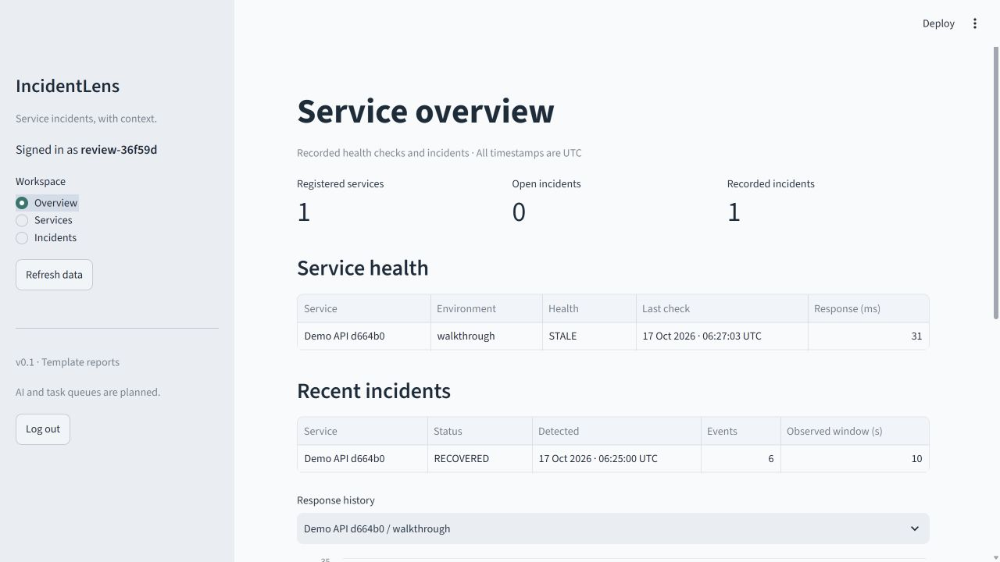
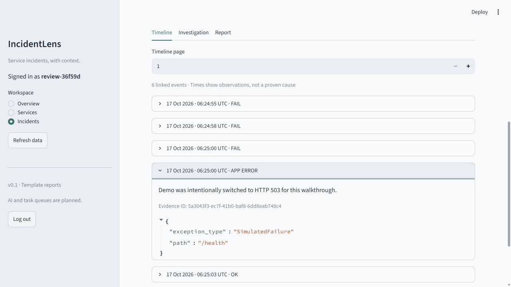
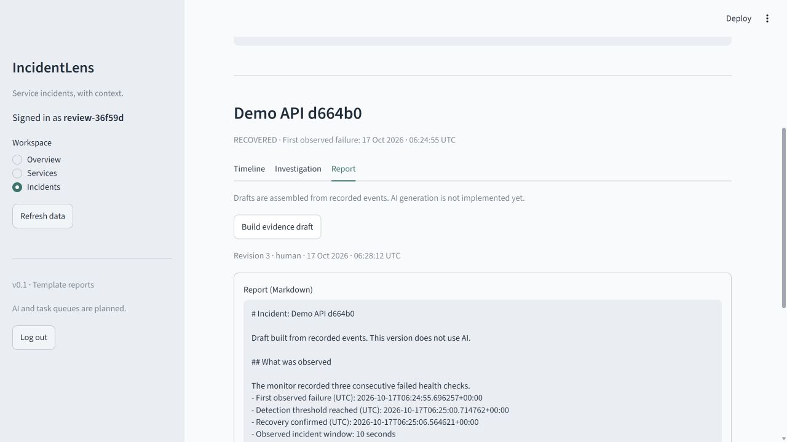

# Demo and verification

## Walkthrough

Start the API and Flask demo using the README steps. Stop any continuous monitor during the scripted walkthrough so the script controls the number of checks.

```text
uv run python scripts/demo_walkthrough.py
```

The script creates a service with `walkthrough` as its environment. It makes real HTTP requests to the API and demo service. It does not fill the database with made-up historical incidents.

It checks that:

1. Three failed requests produce one open incident.
2. Sending one application error twice stores it once.
3. Two successful checks mark the incident recovered.
4. The timeline has five health checks and one error event.
5. A template report can be generated and then saved as a second, human-edited revision.

The demo's cause is known because the script deliberately changes its mode. That does not mean the application can diagnose arbitrary failures.

Generated files are saved to ignored `local-artifacts/` and should not be committed with account details or service keys.

## Automated checks

The test suite covers backend behavior and Streamlit rendering. The PostgreSQL-only tests run two threads for concurrent failure handling, duplicate ingestion, and conflicting report edits. The SQLite run skips those tests explicitly.

Local checks on 17 October 2026:

- SQLite test run: **42 passed, 3 skipped**. The skipped cases require PostgreSQL.
- Ruff lint and formatting checks passed.
- Django system checks and migration consistency checks passed.
- The real HTTP walkthrough passed: one recovered incident, six linked events, duplicate error stored once, and two report revisions.
- The running Streamlit app was checked in a browser: login, dashboard, timeline evidence, and a third report revision saved through the editor.
- The Compose configuration passed validation. Docker was not running on the local machine; the separate CI container job builds and exercises the PostgreSQL setup.

The CI badge and workflow logs show the current remote result, including the PostgreSQL tests and container walkthrough.

## Screens from the running app

These are captures from the local SQLite walkthrough, not design mockups.






